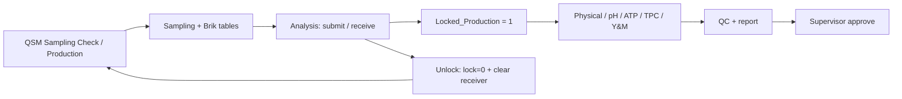

# QSM Microbiological Analysis System

คู่มือส่งต่องานสำหรับนักพัฒนา: แอป Budibase ฝั่ง QSM รับตัวอย่างจาก **QSM Sampling Check** และจัดการผลตรวจผลิตภัณฑ์สำเร็จรูป Low Acid/High Acid ตั้งแต่รับงาน ตรวจ30/55°C บันทึกผล physical/microbe นำเข้า CSV จัดการ QC จนถึงรายงานและอนุมัติ.

หลักฐาน: latest edited app export วันที่ **2026-10-12** — **66 queries, 22 screens, 11 imported table schemas และ2ตารางอ้างเพิ่มใน SQL**. รักษาชื่อจริงตาม Builder รวมคำสะกด `Quanity`, `Recieved`, `qulilty` และ `Update  Results`.

## เริ่มอ่าน

1. [การเชื่อมต่อกับ QSM Sampling Check และสัญญาข้อมูล](integration/README.md)
2. [Database design / ER diagram / data dictionary](database/README.md)
3. [Query catalog — อธิบายครบ66ตัวและลิงก์ SQL](database/Query/README.md)
4. เลือกหน้าจอจากตารางด้านล่างเพื่อดู fields/actions/JavaScript/data providers
5. [ขอบเขตหลักฐานและงานบำรุงรักษา](document/README.md)

## โครงสร้างไฟล์

```text
QSM Microbiological Analysis System/
├── README.md
├── database/
│   ├── README.md                 # ER + table index
│   ├── Query/
│   │   ├── README.md             # รายละเอียดรวมทุก query
│   │   ├── manifest.json         # query ID, bindings, source hash
│   │   └── <ชื่อ query>.sql       # SQL จริง + comment ชื่อกำกับ
│   └── tables/<table>/README.md
├── integration/README.md        # QSM Sampling Check
├── <screen-route>/README.md     # รายละเอียด22หน้าจอ
└── document/README.md
```

## Workflow



## Design Screens

ชื่อ folder แปลง route เป็น slug และตัด route parameter ออกจากชื่อ folder; route จริงยังแสดงครบในเอกสาร.

| Route | Access | หน้าที่ | README |
|---|---|---|---|
| `/a4` | BASIC | หน้ารูปแบบ A4 ตั้ง access BASIC | [เปิด](a4/README.md) |
| `/a4-highacid` | BASIC | หน้า A4 High Acid ตั้ง access BASIC และยังมี action Update_Sup_HighAcid ใน modal Approve | [เปิด](a4-highacid/README.md) |
| `/bottom-shrink-sampling-choose` | PUBLIC | แสดง layout กล่อง Low Acid30/55 จาก CallProduct_Temp30/55 | [เปิด](bottom-shrink-sampling-choose/README.md) |
| `/edit-page/:sampid` | PUBLIC | หน้าปรับข้อมูล High Acid ใช้ Call_Edit_Page และ CallBackTable | [เปิด](edit-page/README.md) |
| `/high-acid` | PUBLIC | ค้น Sampling High แล้วทำฟอร์มส่ง/รับตัวอย่าง | [เปิด](high-acid/README.md) |
| `/high-acid-report/:sampid` | PUBLIC | รายงาน High Acid รวม CallBack Sampling_HighAcid, CallBackTable และ Batch_Recall | [เปิด](high-acid-report/README.md) |
| `/high-acid-sampling-tables` | PUBLIC | รายการ High Acid จาก HighAcid_Tables พร้อมตัวกรองวันผลิต/วันตรวจ/เครื่อง/SamplingID | [เปิด](high-acid-sampling-tables/README.md) |
| `/high-acid/bottom-shrink` | PUBLIC | ตรวจ High Acid แบบหลาย sampling: TPC Pass, Y&M Pass และ Physical เขียนผลทุก Brik ของรายการที่เลือก | [เปิด](high-acid-bottom-shrink/README.md) |
| `/high-acid/choose-sampling` | PUBLIC | เลือก High Acid จาก CheckList Sampling หรือเครื่องสแกน | [เปิด](high-acid-choose-sampling/README.md) |
| `/high-acid/quanity-control/add` | PUBLIC | จัดการ QC media/batch ของหลาย sampling: อ่าน Quanity Table, เพิ่มด้วย Quanity_Control_Added, ลบราย id ด้วย Remove_Qc Table และตั้ง Pass ทั้งชุดด้วย Qunity_pass | [เปิด](high-acid-quanity-control-add/README.md) |
| `/high-acid/qulilty-control/choose-sampling` | PUBLIC | เลือกหรือสแกน sampling สำหรับ QC ผ่าน CheckList Sampling แล้วเก็บ state Samplings_highacid_batch และไปหน้าบันทึก QC | [เปิด](high-acid-qulilty-control-choose-sampling/README.md) |
| `/high-acid/sampling-tracker/:sampid` | PUBLIC | พบ route ที่ยังอยู่ใน export แต่ไม่มี query reference หรือ event actions | [เปิด](high-acid-sampling-tracker/README.md) |
| `/home/menu-selector/:userid` | PUBLIC | เมนูหลักแยก Low Acid/High Acid โดย state toggle_pages; มีทางไปหน้ารับตัวอย่าง ตรวจกล่อง ตารางงาน และ QC | [เปิด](home-menu-selector/README.md) |
| `/in-out-csv/:sampid` | PUBLIC | หน้า export/import ข้อมูล30/55 | [เปิด](in-out-csv/README.md) |
| `/login` | PUBLIC | หน้าเริ่มต้น: ตรวจ input, เรียก Login_API, sync จำนวน Brik ทั้ง Low/High, ประมวลผล state LoginDB_API/CallbackDB_API, ลง activity log แล้วไปเมนู | [เปิด](login/README.md) |
| `/low-acid` | PUBLIC | รับและแก้ไขรายละเอียด Low Acid จากตัวอย่างที่ Production สร้าง | [เปิด](low-acid/README.md) |
| `/report-low/:samp` | PUBLIC | รายงาน Low Acid จาก CallBack Sampling และ Report_List_Page พร้อมตาราง30/55 และปุ่มกลับรายการ | [เปิด](report-low/README.md) |
| `/sampling-product-for-milk-box` | PUBLIC | เลือก Size/วันผลิต แล้วเลือกหรือสแกน sampling ได้สูงสุด6ช่อง | [เปิด](sampling-product-for-milk-box/README.md) |
| `/sampling-tables` | PUBLIC | ศูนย์รวมงาน Low Acid: กรองวันที่/เครื่อง/SamplingID และแสดงสถานะจาก SamplingTable | [เปิด](sampling-tables/README.md) |
| `/sampling-tracker/:sampid` | PUBLIC | อ่าน CallBack Sampling แสดงสถานะ/ข้อมูลติดตามของ sampling และมีปุ่ม Supervisor ไป supervisor-report ของรายการนั้น พร้อมกลับ sampling-tables | [เปิด](sampling-tracker/README.md) |
| `/supervisor-report/:samp` | PUBLIC | รายงาน Low Acid พร้อมข้อมูลหัว/ราย Brik และ modal อนุมัติผ่าน Sup_Approve | [เปิด](supervisor-report/README.md) |
| `/table-time-check-30-55/:sampid` | PUBLIC | หน้าตรวจผลราย Brik30/55: อ่าน CallProduct30/55, แก้ colour/smell/TPC ด้วย UpdateTemp30/55; กำหนด test flags ของหัวและลงผู้ตรวจ physical/results | [เปิด](table-time-check-30-55/README.md) |

## ข้อสำคัญในการรับช่วง

- เชื่อมสองแอปผ่านตารางและ business keys ตาม SQL; ยังไม่ได้ยืนยัน connection string ของ Sampling Check จาก live export รอบนี้.
- 20หน้าตั้ง PUBLIC และ2หน้าตั้ง BASIC; อ่าน login/state/conditions จากเอกสารหน้าจอ.
- Login เรียก sync quantity ทั้งฐาน; quantity ใช้ no ของ id ล่าสุด ไม่ใช่ COUNT.
- คำสั่ง SQL เดิมเก็บครบ ไม่เพิ่ม COMMIT หรือแก้ logic; Git commit แยกการส่งออก SQL กับเอกสาร.
- ไม่รวม credentials, datasource connection settings หรือแถวข้อมูลธุรกิจในชุดนี้.
- ใช้รูปแบบโฟลเดอร์อ้างอิง [QSM Sampling Check](https://github.com/Tkyaemsuk/Digitalization_QSM_AND_PRP_Project/tree/main/QSM%20Sampling%20Check).
