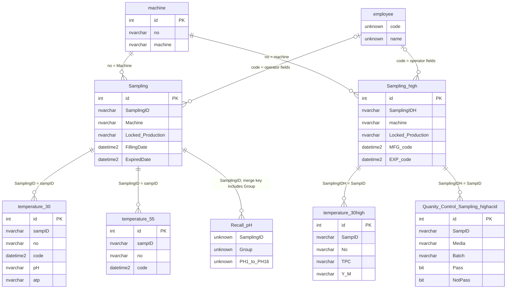
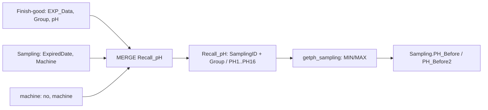

# Database Design

[หน้าหลัก](../README.md) · [Query](Query/README.md) · [Integration](../integration/README.md)

มี **11 imported table schemas** และอีก **2 ตารางที่ SQL อ้างอิง** รวมเอกสาร13ตาราง. PK ด้านล่างตาม metadata ของ Builder; ไม่ยืนยัน unique constraint ของ business key. ขนาดข้อความ, default, index, FK และ SQL nullability ที่ไม่ได้ระบุใน export ต้องอ่าน DDL จริงเพิ่ม.

## ตารางทั้งหมด

| ตาราง | หน้าที่ | Schema | เอกสาร |
|---|---|---|---|
| `app_activity_log` | บันทึกกิจกรรมที่ action app_logs ส่งมา; แยกจากข้อมูลผลตรวจ. | Builder | [README](tables/app-activity-log/README.md) |
| `Finish-good` | แหล่งข้อมูลตรวจ Finished Goods; query ดึง pH โดยเทียบวันหมดอายุและกลุ่มเครื่องจักร. | Builder | [README](tables/finish-good/README.md) |
| `machine` | master เครื่องจักร; queries JOIN ผ่าน no ขณะที่ Builder PK คือ id. | Builder | [README](tables/machine/README.md) |
| `machine_size` | master ขนาดตามเครื่องจักร/DEP/GROUP; ตรวจใช้ผ่าน table providers ในหน้าจอด้วย. | Builder | [README](tables/machine-size/README.md) |
| `Quanity_Control_Sampling_highacid` | รายการ QC ต่อ SamplingIDH: No/Media/Batch/Pass/NotPass. | Builder | [README](tables/quanity-control-sampling-highacid/README.md) |
| `Sampling` | หัวงาน Low Acid จาก Production: ข้อมูลผลิต/ส่ง/รับ แผนบ่ม ผลระดับหัว ผู้ตรวจ และอนุมัติ. | Builder | [README](tables/sampling/README.md) |
| `Sampling high` | หัวงาน High Acid: ข้อมูลผลิต การส่ง/รับ การเก็บรักษา ตรวจ physical/microbe และ supervisor. | Builder | [README](tables/sampling-high/README.md) |
| `tb_app1_login` | บัญชีสำหรับ Login_API; dictionary นี้ระบุ schema เท่านั้น ไม่เผยแพร่แถวบัญชี. | Builder | [README](tables/tb-app1-login/README.md) |
| `temperature_30` | Brik Low Acid30°C: รหัส sampling, ลำดับกล่อง/เวลาผลิต, ผล pH/ATP/TPC สี/กลิ่น และผลตรวจซ้ำ. | Builder | [README](tables/temperature-30/README.md) |
| `temperature_30high` | Brik High Acid: TPC/Y_M, Colour/Smell/Appearance และข้อมูล product/flavour. | Builder | [README](tables/temperature-30high/README.md) |
| `temperature_55` | Brik Low Acid55°C ใช้โครงสร้างคู่กับ30°C แต่เก็บคนละตาราง. | Builder | [README](tables/temperature-55/README.md) |
| `employee` | lookup ชื่อผู้ปฏิบัติงานจาก code ผ่าน JOIN หลายบทบาท; ไม่พบ imported schema ใน export. | SQL reference | [README](tables/employee/README.md) |
| `Recall_pH` | ตารางกลาง pH1–PH16 สร้าง/อัปเดตด้วย MERGE ตาม SamplingID+Group; ไม่พบ imported schema ใน export. | SQL reference | [README](tables/recall-ph/README.md) |

## ER Diagram (logical relationships)

เส้นด้านล่างอิง JOIN และ business key ใน SQL; cardinality เป็นแบบจำลองการใช้งาน ไม่ใช่หลักฐานว่ามี FK/unique constraints บน SQL Server. ชื่อ entity ที่มีช่องว่างแปลงเป็น underscore ในรูปเท่านั้น.

`unknown` หมายถึงไม่พบ schema type ใน export. employee, Recall_pH ไม่มีการประกาศ PK ที่ยืนยันจากหลักฐานชุดนี้. machine_size, Finish-good, tb_app1_login และ app_activity_log มี dictionary แยก; ไม่วาด FK ที่ยังไม่พบ.

## เส้นทาง pH จาก Finish-good

เงื่อนไขเชื่อมเป็นวันหมดอายุเดียวกันและ Group ตรงตัวอักษรแรกของชื่อเครื่องจักร; ไม่ใช่ foreign key ตรงกับ Finish-good.id.
