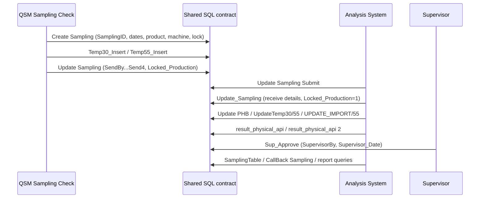
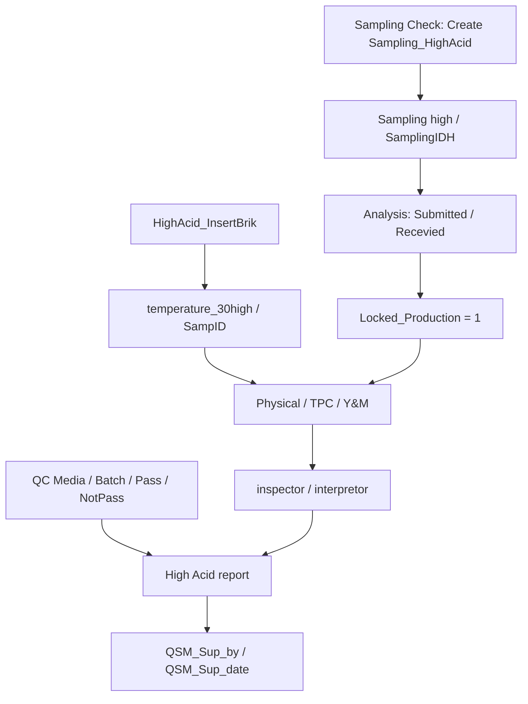

# การเชื่อมต่อ QSM Sampling Check ↔ QSM Microbiological Analysis System

[หน้าหลัก](../README.md) · [Database / ER](../database/README.md) · [Query catalog](../database/Query/README.md)

## 1. ขอบเขตของสองแอป

| แอป | บทบาทตาม source ที่อ่าน | ข้อมูลหลัก |
|---|---|---|
| QSM Sampling Check | ฝ่าย Production สร้าง Sampling, เพิ่ม Brik30/55 หรือ High Acid และระบุผู้ส่ง/lock | Sampling, Sampling high, temperature_30, temperature_55, temperature_30high |
| QSM Microbiological Analysis System | รับ/ส่งตัวอย่างสำหรับ QSM, กำหนดแผนตรวจ, บันทึก physical/microbe, import ผล pH/ATP, QC, รายงานและ supervisor | ตารางร่วมด้านบน + Quanity_Control_Sampling_highacid, Finish-good, Recall_pH, app_activity_log |

หลักฐานแสดงการเชื่อมผ่าน **ตารางและ business keys ที่ตรงกันใน SQL**. ยังไม่ได้อ่าน connection configuration ของ Sampling Check แบบ live ในรอบนี้ จึงไม่ยืนยันชื่อ server/database เดียวกันจากชื่อ table เพียงอย่างเดียว. ฝั่ง Analysis ใช้ datasource `MS SQL Server` ID `datasource_plus_0506fb2c937c4682933d3acce4fc69b0`.

ไม่พบ automation document ใน export ของ Analysis รอบนี้. ไม่พบ Navigate URL ไปอีกแอปจาก screen configuration ที่อ่าน; การส่งต่อหลักที่ยืนยันได้คือข้อมูลใน SQL และสถานะ lock. ก่อนเปลี่ยนปลายทาง datasource ให้ตรวจ connection settings ของทั้งสองแอปในระบบที่มีสิทธิ์ โดยไม่คัดลอก credentials มาไว้ใน repository.

## 2. Data contract ที่ใช้ร่วมกัน

| Contract | Sampling Check เขียน | Analysis อ่าน/เขียน | ความหมาย/ข้อจำกัด |
|---|---|---|---|
| Low Acid header | Sampling.SamplingID | Sampling.SamplingID | Business key; Builder ของ Analysis ระบุ PK เป็น id ไม่ใช่ SamplingID |
| Low Acid Brik30 | temperature_30.sampID, no, code, status | อ่าน/แก้ผล temperature_30 | JOIN sampID=SamplingID; no เป็น nvarchar; code เป็น datetime2 |
| Low Acid Brik55 | temperature_55.sampID, no, code, status | อ่าน/แก้ผล temperature_55 | แยกตารางจาก30; Table_55 คืนได้สูงสุด15แถว แต่ query อื่นอ่านได้มากกว่า |
| High Acid header | Sampling high.SamplingIDH | Sampling high.SamplingIDH | Business key; Builder ระบุ PK เป็น id |
| High Acid Brik | temperature_30high.SampID, No, Code, Status, Product, Flavour | ผล TPC/Y_M/Colour/Smell/Appearance | JOIN SampID=SamplingIDH |
| Production lock | Locked_Production | ตั้ง1เมื่อรับ; ตั้ง0เมื่อ unlock | เป็น nvarchar; การบังคับไม่ให้แก้ต้องตรวจ UI/server ของแต่ละแอป |
| ผู้ส่ง | SendBy, SendBy2, SendBy3, Send4 | JOIN employee.code เพื่อแสดงชื่อ | SQL จริงใช้ Send4; อย่าเปลี่ยนเป็น SendBy4 ตามข้อความใน README เก่า |
| Machine | Sampling.Machine / Sampling high.machine | JOIN machine.no | machine PK ใน Builder คือ id; no เป็น business lookup key |
| วันผลิต/หมดอายุ | FillingDate/ExpiredDate หรือ MFG_code/EXP_code | ใช้ค้นรายการ คำนวณแผน และจับคู่ Finish-good | บาง query ฝั่งสร้างบวก7ชั่วโมง; ต้องรักษา timezone contract |
| ผลระดับหัว | — | PH/Colour/Smell/Tpc/Atp และชุด2 หรือ TPCH/Y_M/Physical_T | ส่วนใหญ่เป็น bit flags ระบุการตรวจ; แยกจากค่าตรวจราย Brik |

คอลัมน์ `sampling_ref_id` มีใน schema ตาราง Brik แต่ SQL ที่อ่านยัง JOIN ผ่าน `sampID`/`SampID`; ห้ามสรุปว่าเปลี่ยนความสัมพันธ์ไปใช้ sampling_ref_id แล้ว.

## 3. Low Acid: Production → Analysis → อนุมัติ

### ขั้นตอนและข้อมูลที่เปลี่ยน

1. Sampling Check ใช้ `Create Sampling` เพิ่มหัว พร้อม Temperature='30', Temperature2='55', Product_Link และ CreatedBY=SYSUTCDATETIME(). วันผลิต/หมดอายุใช้ DATEADD(HOUR,7,...).
2. `Temp30_Insert`/`Temp55_Insert` สร้าง Brik จาก MAX(TRY_CAST(no AS INT))+1. Qty ต่อครั้งถูกจำกัด6 แต่เงื่อนไขจำนวนรวมใน SQL เป็น100 แม้คอมเมนต์บางบรรทัดกล่าวถึง6. Analysis ต้องอ่าน SQL จริงเมื่อกำหนดจำนวนกล่องสูงสุด.
3. Query ฝั่ง Production `Update Sampling` ลงผู้ส่งและ lock. ชื่อเดียวกับ `Update_Sampling` ฝั่ง Analysis แต่เป็น **คนละ query และทำหน้าที่ต่างกัน**.
4. Analysis หน้า [/low-acid](../low-acid/README.md) บันทึก submit และ receive แยก query. Receive ตั้ง Locked_Production='1' และลง RecevieBy/Recieved_date พร้อมรายละเอียดตัวอย่าง.
5. ตรวจรายกล่องที่ [/table-time-check-30-55/:sampid](../table-time-check-30-55/README.md), ตรวจแบบ layout ที่ [/bottom-shrink-sampling-choose](../bottom-shrink-sampling-choose/README.md) หรือ import ที่ [/in-out-csv/:sampid](../in-out-csv/README.md).
6. Supervisor อนุมัติผ่าน Sup_Approve. Query SamplingTable คืน success จาก SupervisorBy ไม่ NULL โดยไม่ได้คำนวณความครบของผลตรวจใน query รายการ.

## 4. High Acid: รับตัวอย่าง ตรวจผล และ QC

- Sampling Check สร้าง Sampling high พร้อม Locked_Production='0', MFG_code/EXP_code +7 ชั่วโมง.
- HighAcid_InsertBrik เติม No/Code/Status/Product/Flavour/SampID. SQL ใช้ recursive CTE เริ่มที่1เสมอ: ถ้า Qty<=0 อาจยังสร้าง1แถวจาก anchor; ประเด็นนี้อยู่ฝั่ง Sampling Check source ที่อ้างอิง ไม่ได้แก้ในงานเอกสารนี้.
- Analysis หน้า [/high-acid](../high-acid/README.md) ใช้ Update_HighAcid_Submitted_Sampling และ Update_HighAcid_Recevied. การรับลง recieved_by/recieved_date และ lock=1.
- [/high-acid/bottom-shrink](../high-acid-bottom-shrink/README.md) เขียน TPC/Y_M/physical ให้ทุก Brik ของ sampling ที่เลือก แล้วลงผู้ตรวจ inspector/interpretor แยก query.
- QC อยู่ใน Quanity_Control_Sampling_highacid; เพิ่มหนึ่งแถวต่อ SamplingID ในรายการ CSV. Batch_Recall pivot ได้10ลำดับ, การตั้ง Pass ทั้งชุดไม่ได้ล้าง NotPass.
- [/high-acid-report/:sampid](../high-acid-report/README.md) รวมข้อมูลหัว Brik และ QC แล้วลง QSM_Sup_by/date. CallBack Sampling_HighAcid JOIN QC อาจคืนหัวซ้ำหลายแถว.

## 5. วงจรปลดล็อกส่งกลับ Production

| ขั้นตอน | Low Acid | High Acid |
|---|---|---|
| รับงาน | Update_Sampling | Update_HighAcid_Recevied |
| ผลต่อ lock | Locked_Production='1' | Locked_Production='1' |
| ปลดล็อก | UnlockSamp_Production | UnlockSamp_HighAcid_Production |
| ผู้รับถูกล้าง | RecevieBy=NULL, Recieved_date=NULL | recieved_by=NULL, recieved_date=NULL |
| บันทึกผู้ปลดล็อก | Unlocked_Uid={{Userid}} | Unlocked_Uid={{Userid}} |
| ผลต่อ lock | Locked_Production='0' | Locked_Production='0' |
| สิ่งที่ query ไม่ล้าง | SupervisorBy, ผลตรวจเดิม, submit | QSM_Sup_by, ผลตรวจเดิม, submit |

ดังนั้นการ unlock หลังอนุมัติ **อาจยังแสดง success** เพราะ query รายการตรวจ supervisor ก่อนผู้รับ. ต้องกำหนดขั้นตอนตรวจซ้ำ/อนุมัติซ้ำร่วมกับผู้ดูแลกระบวนการก่อนเปลี่ยน logic. เอกสารนี้บันทึกพฤติกรรมปัจจุบัน ไม่ได้เปลี่ยนค่าหรือปลดล็อกรายการจริง.

## 6. Format และการรวมข้อมูล

### Sampling หลายรายการ

| รูปแบบ | ตัวอย่าง query | สิ่งที่ผู้เรียกต้องส่ง |
|---|---|---|
| 6 bindings แยก | CallProduct_Temp30/55, ColourCode, Physical_Report | s1–s6 หรือ sampID–sampID6 ตามชื่อจริง |
| CSV STRING_SPLIT | Update_Sup_HighAcid, Quanity_Control_Added, Bottom_Recall | string คั่น comma; ระวัง token ว่าง/ซ้ำตาม query |
| SQL IN list | Quanity Table | ผล binding ที่เหมาะกับ IN(...) ไม่เท่ากับ CSV string โดยอัตโนมัติ |
| JSON array | UPDATE_IMPORT/55 | object ที่มี sampID,no,pH/ph,atp |

### เวลาและวันที่

- ฝั่งสร้าง Sampling บาง query บวก7ชั่วโมงก่อนเขียน ขณะที่ CreatedBY ใช้ UTC.
- CallBack Sampling เพิ่ม7ชั่วโมงเฉพาะการแสดง Time ของ CreatedBY; วันหัวหลายคอลัมน์แค่ CONVERT รูปแบบวันที่.
- CallBack Sampling_HighAcid เพิ่ม7ชั่วโมงให้วันเวลา submit/receive/inspector/interpretor/supervisor ตอนแสดงผล.
- Query รับ/ส่ง High Acid บางตัว CONVERT ด้วย style101; วันใน binding ต้องตรง contract ที่หน้าจอส่งจริง.
- อย่าเพิ่ม DATEADD(HOUR,7) ให้ทุกคอลัมน์โดยอัตโนมัติ เพราะอาจเกิดการชดเชยซ้ำ.

### จำนวนกล่องและการแสดงผล

- Login เรียก SYNC_QUNITY_SAMPLINGS และ SYNCHIGH_QUNITY_SAMPLINGS ทุกครั้งตาม action list โดยไม่มี WHERE จำกัดตัวอย่าง.
- Quanity/Quanity2/amount มาจาก **no ของแถว id ล่าสุด**; ถ้าเลขข้ามหรือมีการลบจะไม่เท่ากับ COUNT. ไม่พบ Brik จะถูกตั้ง NULL.
- Layout Low Acid เลือกทั้งกลุ่ม sampling ที่ยอดสะสมไม่เกิน192 ไม่ได้ trim แถวให้ครบ192.
- CallBackTable/Report_List_Page หน้าละ30; Table_55 จำกัด15; Batch_Recall มี10ชุด QC. แต่ละข้อเป็นขอบเขตของ query ไม่ใช่ข้อจำกัดกลางของระบบ.

## 7. รายการเปลี่ยนแปลงที่ต้องประสานสองแอป

1. เปลี่ยนรูปแบบ SamplingID/SamplingIDH หรือขนาดคอลัมน์: ตรวจ JOIN, route parameter, scan input, JSON import และ string list ทุกจุด.
2. เปลี่ยน no/code หรือวิธีเพิ่ม Brik: ตรวจ MAX(no), latest-id quantity sync, GROUP no+code และ import key sampID+no.
3. เปลี่ยน lock: ตรวจทั้ง Production UI และ Analysis receive/unlock; query source อย่างเดียวไม่ได้รับประกันการป้องกันการแก้ข้อมูล.
4. เปลี่ยน machine.no: ตรวจ lookup ทุก query รวม pH recall ที่จับ Group จากอักษรแรกของชื่อเครื่อง.
5. เปลี่ยนฟิลด์วันที่: ตกลง timezone และ format ของทั้งสองแอปก่อน migrate.
6. เพิ่ม test flags หรือสถานะอนุมัติ: อัปเดต schema, Query README, bindings, report และเงื่อนไขสถานะพร้อมกัน.

## 8. หลักฐานฝั่ง Sampling Check

อ่านจาก repository ณ main commit `cf59a8512b4f1bae9e5b8ba363daf4ab2663ead5` วันที่2026-10-12. SQL แหล่งนี้อาจต่างจาก live app ที่แก้ภายหลัง:

- [Create Sampling](<https://github.com/Tkyaemsuk/Digitalization_QSM_AND_PRP_Project/blob/cf59a8512b4f1bae9e5b8ba363daf4ab2663ead5/QSM%20Sampling%20Check/database/Query/Create%20Sampling.sql>)
- [Create Sampling_HighAcid](<https://github.com/Tkyaemsuk/Digitalization_QSM_AND_PRP_Project/blob/cf59a8512b4f1bae9e5b8ba363daf4ab2663ead5/QSM%20Sampling%20Check/database/Query/Create%20Sampling_HighAcid.sql>)
- [Temp30_Insert](<https://github.com/Tkyaemsuk/Digitalization_QSM_AND_PRP_Project/blob/cf59a8512b4f1bae9e5b8ba363daf4ab2663ead5/QSM%20Sampling%20Check/database/Query/Temp30_Insert.sql>) / [Temp55_Insert](<https://github.com/Tkyaemsuk/Digitalization_QSM_AND_PRP_Project/blob/cf59a8512b4f1bae9e5b8ba363daf4ab2663ead5/QSM%20Sampling%20Check/database/Query/Temp55_Insert.sql>)
- [HighAcid_InsertBrik](<https://github.com/Tkyaemsuk/Digitalization_QSM_AND_PRP_Project/blob/cf59a8512b4f1bae9e5b8ba363daf4ab2663ead5/QSM%20Sampling%20Check/database/Query/HighAcid_InsertBrik.sql>)
- [Update Sampling](<https://github.com/Tkyaemsuk/Digitalization_QSM_AND_PRP_Project/blob/cf59a8512b4f1bae9e5b8ba363daf4ab2663ead5/QSM%20Sampling%20Check/database/Query/Update%20Sampling.sql>) / [Update Sampling HighAcid](<https://github.com/Tkyaemsuk/Digitalization_QSM_AND_PRP_Project/blob/cf59a8512b4f1bae9e5b8ba363daf4ab2663ead5/QSM%20Sampling%20Check/database/Query/Update%20Sampling%20HighAcid.sql>)
- [Sup_Production_Update](<https://github.com/Tkyaemsuk/Digitalization_QSM_AND_PRP_Project/blob/cf59a8512b4f1bae9e5b8ba363daf4ab2663ead5/QSM%20Sampling%20Check/database/Query/Sup_Production_Update.sql>) / [SupHighAcid_Production_Update](<https://github.com/Tkyaemsuk/Digitalization_QSM_AND_PRP_Project/blob/cf59a8512b4f1bae9e5b8ba363daf4ab2663ead5/QSM%20Sampling%20Check/database/Query/SupHighAcid_Production_Update.sql>)

หาก README เก่าระบุ Primary key หรือชื่อคอลัมน์ต่างจาก export รอบนี้ ให้ยึดระดับหลักฐานให้ถูกต้อง: SQL ระบุการใช้งาน; imported schema ระบุสิ่งที่ Builder รู้; DDL จริงจึงยืนยัน constraint ได้.
