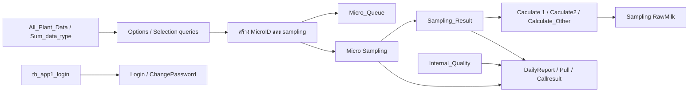

# คู่มือ SQL Query ของ QSM Microbiological

เอกสารรวมนี้อธิบาย SQL query ทั้งหมดที่พบใน Data > MS SQL Server > Queries ของแอป Budibase **QSM Microbiological** โดยอ่านจาก SQL body ใน Builder ณ วันที่ 12 ต.ค. 2026 ไม่ใช่คำอธิบายจากชื่ออย่างเดียว

> ชื่อ query คงตามใน Builder (รวมตัวสะกดเดิม) เพื่อค้นหาได้ตรงกัน เอกสารนี้อธิบายเจตนาของโค้ด ไม่ได้แทนการทดสอบบนฐานข้อมูลจริง พารามิเตอร์ที่เขียนเป็น `{{ชื่อ}}` คือ binding จาก Budibase; อย่านำค่าจริงหรือ connection string มาใส่ใน GitHub

## ภาพรวมการทำงาน

แอปสร้าง MicroID/รายการ sampling จาก master data และคิวงาน จากนั้นสร้างหรือดึง `Sampling_Result` เพื่อบันทึกผลแล็บ คำนวณผลตามชนิดการทดสอบ อัปเดตสถานะ/ผู้ตรวจ/ผู้อนุมัติ และแสดงรายงาน ข้อมูลอ้างอิงที่เห็นใน SQL รวมถึง `All_Plant_Data`, `Sum_data_type`, `Micro`, `Micro Sampling`, `Sampling_Result`, `Sampling RawMilk`, `Internal_Quality`, ตาราง `MPN_INDEX_*`, `template`, `tb_app1_login` และ `Micro_Queue` บาง query ทำงานเป็น transaction และเขียนหลายตาราง

ชื่อ flow/table ใน diagram อ้างตาม SQL ที่พบ; เป็นภาพรวมเชิงโปรแกรม ไม่ได้ยืนยัน foreign key constraint

## รายละเอียด query

### คำนวณและบันทึกผลตรวจ

#### `Caculate 1`

- **หน้าที่:** คำนวณผล microbiological จากค่าหลอด/ความเจือจางตาม dilution ที่เลือก แล้วอัปเดตผลของตัวอย่าง
- **การทำงาน:** แปลง `CalculateType` เป็นชื่อมาตรฐาน (`TPC`, `YM`, `35C`, `55C`, `COLIFORM`, `ECOLI`); แปลง `Check1`–`Check20` จาก `1/0`, `true/false`, `yes/no`, `on/off` เป็น bit; เทียบ checkbox pattern กับ `template`; รวมค่าจากหลอดที่เลือก, หารด้วยค่า template, กำหนดหลักนัยสำคัญและปัดเศษแบบ ties-to-even; เขียนเฉพาะคอลัมน์ผลของชนิดที่ขอ
- **แถวเป้าหมาย:** `Sampling_Result` ระบุด้วย `SampID + Batch_Lot_no + No`; `No` รองรับทศนิยมและ Batch เก็บ/เทียบเป็นข้อความ
- **ผลข้างเคียง:** ใช้ `OUTPUT` เก็บผลที่อัปเดต แล้วนำ TPC/Coliform/E.coli ไปลง tank 1–3 ของ `Sampling RawMilk` เฉพาะ batch ที่แปลงเป็นเลข 1–3 ได้; batch รูปแบบข้อความไม่ทำให้ conversion error และไม่ถูก map ลง tank
- **พารามิเตอร์สำคัญ:** `CalculateType`, `Check1`–`Check20`, `SampID`, `Batch_Lot_No`, `No` และชุดค่า `TPC_*`, `Y_M_*`, `35C_*`, `55C_*`, `Coliform_*`, `Ecoli_*`
- **ข้อควรระวัง:** `SET XACT_ABORT ON`; SQL มี `THROW` เมื่อไม่พบ checkbox pattern ใน `template`. ตรวจให้แน่ใจว่าความหมายของ `Power`, สูตรปัดเศษ และ mapping tank ตรงกับขั้นตอนแล็บก่อนเปลี่ยน

#### `Caculate2`

- **หน้าที่:** คำนวณ/ดึงค่า MPN จากตาราง index ตามชุด dilution/tube ที่เลือก
- **การทำงาน:** ใช้ `Choice`, `TestType`, `SampID`, `Power` และค่า dilution/tube เป็นเงื่อนไขค้นหา MPN; มี branch สำหรับ MPN 100 ml แบบปกติและรูปแบบ tube/dilution อื่นจาก `MPN_INDEX_100ml`, `MPN_INDEX_100ml_10_0`, `MPN_INDEX_100ml_10_1`, `MPN_INDEX_100ml_5`; เขียนผลที่เกี่ยวข้องลง `Sampling_Result` และผลกลุ่ม Coliform/E.coli ตาม branch
- **พารามิเตอร์หลัก:** `Choice`, `TestType`, `SampID`, `Power`, ค่าหลอด/ความเจือจาง เช่น `10_ml`, `1_ml`, `0_1_ml`, `Tubes` และ bindings ชุด b13/b14
- **ข้อควรระวัง:** ตรวจ mapping ระหว่างชื่อ field กับ dilution/tube ที่หน้าจอส่งมา เพราะการเลือกผิดทำให้ได้ index คนละชุด

#### `Calculate_Other`

- **หน้าที่:** คำนวณผลสำหรับกลุ่ม “Other” จาก checkbox/dilution โดยใช้รูปแบบการรวมและปัดเศษคล้าย `Caculate 1`
- **การทำงาน:** normalize `Check1`–`Check20`, จับคู่รูปแบบกับ `template`, รวมผลจากชุด `Other_*`, คำนวณค่าและปรับหลัก/ปัดเศษผ่าน CTE แล้วอัปเดตแถว `Sampling_Result`
- **พารามิเตอร์หลัก:** `Check1`–`Check20`, `Other_*` และตัวระบุแถว/ชนิดการคำนวณตาม binding ใน query
- **ข้อควรระวัง:** ตรวจ `WHERE` และคอลัมน์ผลปลายทางก่อนแก้ เนื่องจาก query ประกอบด้วยหลาย CTE ที่ใช้ชื่อคล้าย query คำนวณตัวอื่น

### อ่านผลและรายงาน

#### `Callresult`

- **หน้าที่:** เลื่อนเลือกแถวผลตรวจใน MicroID เดียวแบบหลายผลลัพธ์
- **การทำงาน:** ใช้ `MicroID`, `State`, `Direction`; `Direction=1` คือ Next, `-1` คือ Previous, `0` คง state; รองรับ state 0 ที่ยังไม่เลือก `Sampling_Result`; ใช้ `Sampling_Result.id` ระบุแถวเมื่อ MicroID เดียวมีหลายผล และคืน Date/Time/Batch/Item พร้อมข้อมูล sampling
- **ตาราง:** `Micro Sampling`, `Sampling_Result`
- **ข้อควรระวัง:** ครอบ transaction; อย่าเปลี่ยนการเรียงลำดับผลโดยไม่ทดสอบ Next/Previous และขอบเขตแถวแรก/สุดท้าย

#### `CallResult_Batch`

- **หน้าที่:** ดึงคอลัมน์ทั้งหมด (`sr.*`) ของผลตรวจหนึ่งแถว
- **เงื่อนไข:** เทียบ `SampID` และ `No` หลัง trim และแปลงเป็นข้อความ
- **ตาราง:** `Sampling_Result`

#### `DailyReport_Microbiological 1`

- **หน้าที่:** สร้างชุดข้อมูลรายงาน Micro พร้อมข้อมูล Internal Quality และ Employee
- **การทำงาน:** ใช้ CTE รวมข้อมูล Micro, Internal Quality, employee และ Micro Sampling; เลือกรายการ MPN แรกตาม logic ใน SQL และรวม/จัดรูป item สำหรับรายงาน
- **ตาราง:** `Micro`, `Internal_Quality`, `Micro Sampling`, `Sampling_Result` และชุดข้อมูล employee ที่ query อ้างถึง
- **ข้อควรระวัง:** ตรวจนิยาม “รายการแรก” และ join key หากข้อมูลซ้ำหรือรายงานแสดงจำนวนแถวผิด

#### `DailyReport_Result`

- **หน้าที่:** ดึงผล Micro ในช่วงลำดับ `No` ที่ระบุสำหรับ MicroID
- **การทำงาน:** รับ `Micro`, `StartNo`, `EndNo`; แปลง suffix ของ `No` เช่น `6.1`, `6.2`, `6.10` เป็นลำดับเลขเพื่อกรองช่วง และเพิ่ม Item จาก `Sampling_Result` ในผลรายงาน
- **ตาราง:** `Micro Sampling`, `Sampling_Result`
- **ข้อควรระวัง:** มีการตรวจ/แจ้งกรณีช่วงไม่ถูกต้อง; ทดสอบกรณีเลข suffix มากกว่า 9 เพื่อป้องกันเรียง `6.10` ก่อน `6.2`

#### `MicroID_Table`

- **หน้าที่:** ดึงรายการ MicroID/ข้อมูลสำหรับตารางเลือก โดยกรองวันที่และ Department
- **การทำงาน:** รับ `Date`, `Department`; จัดรูป `Submit_Date` เป็น `DD/MM/YYYY HH:mm:ss` และ Date เป็น `DD/MM/YYYY`; ตัดรายการซ้ำ
- **ตาราง:** `Micro`, `Micro Sampling`
- **ข้อควรระวัง:** การแปลงวันที่เพื่อแสดงผลอาจกระทบการใช้ index/เขตเวลา; ตรวจ locale และ timezone ที่คาดหวัง

#### `Pull_Result`

- **หน้าที่:** ดึงชุดผลตรวจทั้งหมดที่เกี่ยวข้องกับ `MicroID`
- **การทำงาน:** SELECT จาก `Sampling_Result` โดยเชื่อม `Micro Sampling`/`Micro` เพื่อจำกัดรายการตาม MicroID
- **พารามิเตอร์:** `MicroID`
- **ข้อควรระวัง:** ตรวจ join cardinality หากพบผลซ้ำ

#### `Pull_sum_MicroID`

- **หน้าที่:** ดึง/สรุปข้อมูล Micro Sampling ตาม MicroID สำหรับแสดงรายการ/สถานะ
- **การทำงาน:** คืน field หลัก เช่น id, MicroID, SamplingID, Batch และ Status จาก `Micro Sampling`; มีการคัด/จัดการรายการใน SQL
- **พารามิเตอร์:** `MicroID`

#### `Puls_state`

- **หน้าที่:** เพิ่ม state ของ `Micro Sampling` ขึ้น 1
- **SQL:** `State = ISNULL(State, 0) + 1` เฉพาะแถว `MicroID` ที่ระบุ
- **พารามิเตอร์:** `MicroID`
- **ข้อควรระวัง:** การเรียกซ้ำจะเพิ่ม state ทุกครั้ง; ตรวจว่า action/UI ป้องกัน double submit หรือไม่

#### `samplingDate`

- **หน้าที่:** อ่านข้อมูลใน `Sampling RawMilk` ตาม `Date` ที่ส่งเข้ามา
- **ข้อควรระวัง:** query สั้นและคืน row ตามเงื่อนไขวันตรง ๆ; ตรวจชนิด Date/DateTime และขอบเขตเวลาของวัน

#### `SumTable`

- **หน้าที่:** สร้างข้อมูลสรุป/ตาราง Micro Sampling
- **การทำงาน:** อ่าน `Micro Sampling`; จัดรูป Date เป็น `DD/MM/YYYY`, Time เป็น `HH:mm`, อ่าน Status และแยก DataType เป็นคอลัมน์
- **ข้อควรระวัง:** ตรวจ pivot/การรวมกลุ่มหากเพิ่ม DataType ใหม่

### สร้าง MicroID และรายการ sampling

#### `Create Sampling`

- **หน้าที่:** สร้าง sampling หลายรายการตามข้อมูลที่ผู้ใช้เลือก และจัดการคิวการสร้าง
- **การทำงาน:** รับ MicroID, Department, Type, Item, Selection, Sample, State, Name, Machine, Batch, เวลา/วันที่ และตัวเลือก tank เพิ่มเติม; ใช้ split/ตัวเลขลำดับเพื่อแตกค่าเป็นหลายแถว; อ่าน master data/`Sum_data_type`; ใช้ transaction กับ `Micro_Queue` และ `Micro Sampling`; มี validation/rollback เมื่อข้อมูลไม่ผ่าน
- **ข้อควรระวัง:** เป็น write query หลายตารางและมี branch ตามข้อมูลรายการ; ตรวจจำนวนแถว/การสร้างซ้ำและความสอดคล้องของ queue เมื่อแก้

#### `Create_Inprocess`

- **หน้าที่:** สร้างรายการ Micro Sampling สำหรับงาน Inprocess
- **การทำงาน:** แยกค่าที่เลือกซึ่งอาจส่งมาเป็น comma-separated mapping, map Department/Type/Name/Tank จากข้อมูล Inprocess และสร้างงานใน queue/รายการ sampling ภายใน transaction
- **พารามิเตอร์:** Department, Type, Name, Machine, Tank, Page, Date, Time, Batch
- **ข้อควรระวัง:** ชื่อ SQL ระบุว่าแก้ mapping และ running number ระดับ queue; ทดสอบการชนกันของหมายเลขเมื่อมีผู้ใช้สร้างพร้อมกัน

#### `Create_Raw_Milk`

- **หน้าที่:** สร้างชุดงานตรวจน้ำนมดิบและผลที่เกี่ยวข้อง
- **การทำงาน:** รับ MicroID, Batch, remark และ SamplingID; transaction ทำการสร้าง/เชื่อมข้อมูลระหว่าง `Micro Sampling`, `Sampling RawMilk`, `Micro`, `Sampling_Result` พร้อมตรวจเงื่อนไข/rollback
- **ข้อควรระวัง:** เขียนหลายตาราง; ตรวจ idempotency และ rollback เมื่อ insert ขั้นใดขั้นหนึ่งล้มเหลว

#### `Genarate_Inprocess`

- **หน้าที่:** สร้าง preview รายการ/รหัส sampling สำหรับ Inprocess โดยยังเป็น query อ่านข้อมูล
- **การทำงาน:** รับ Department, Type, Name, Date; แยกค่าที่เลือก, map Department/Type/NO จาก Inprocess และสร้างรายการ preview พร้อมหมายเลขลำดับ
- **ตาราง:** `Inprocess` และข้อมูล mapping ที่ประกอบใน CTE

#### `Genarate_MicroID`

- **หน้าที่:** สร้าง/แสดง MicroID ที่จะใช้กับงาน sampling จาก master data
- **การทำงาน:** รับ `dep`, `selection`, `item`, `Date`; อ่าน `All_Plant_Data` แล้วตรวจ/อ้างอิงรายการใน `Micro Sampling`
- **ข้อควรระวัง:** ชื่อสะกด Genarate ตาม Builder; ตรวจรูปแบบรหัสกับ query สร้างจริงก่อนเปลี่ยน

#### `Genarate_Sampling`

- **หน้าที่:** เตรียม/แสดงรายการ sampling จาก department, machine และ item
- **การทำงาน:** รับ `dep`, `machine`, `item`, `Date`; อ่าน master `All_Plant_Data` และ `Micro Sampling` เพื่อประกอบรายการที่เกี่ยวข้อง

#### `Rawmilk_Create_2`

- **หน้าที่:** สร้าง sampling สำหรับ Raw Milk และจัดการรูปแบบวันเวลาให้เป็นมาตรฐาน
- **การทำงาน:** รองรับ input ที่เป็น TIME, DATETIME/DATETIME2 และ ISO string; มี fallback ดึงเวลา; transaction สร้าง/อัปเดต `Micro Sampling`, `Sampling RawMilk`, `Micro`, `Sampling_Result` พร้อมข้อมูล Remark
- **พารามิเตอร์ที่เห็น:** `Remark` และ bindings อื่นที่เกี่ยวกับข้อมูล form ใน query
- **ข้อควรระวัง:** ทดสอบ timezone และ format ที่ browser ส่งจริง โดยเฉพาะ ISO ที่ลงท้าย `Z`

#### `Sampling_Create_2`

- **หน้าที่:** สร้างรายการ sampling ตามประเภท/หน้า/ข้อมูลผลิตภัณฑ์ พร้อมคุม queue
- **การทำงาน:** normalize DataType; หาก Type+Machine+Tank ครบ ใช้ Machine/Tank เป็น ItemValue; Inprocess ใช้ Page ที่ส่งมา ส่วน PlanSwab ไม่ใช้ Page; transaction ตรวจ pending queue และสร้าง/อัปเดต `Micro_Queue`, `Micro Sampling`, `Micro`, `Sampling_Result`
- **พารามิเตอร์ที่เห็น:** Remark, Product, Flavour, DataType, Department, Page และ form bindings อื่น
- **ข้อควรระวัง:** ตรวจ branch DataType, การป้องกันงานซ้ำ และ race condition ที่ queue

### บันทึกผล ตรวจภายใน และอนุมัติ

#### `Save_Inspec&Inter`

- **หน้าที่:** บันทึก/อัปเดตชื่อ Inspector หรือ Interpretor ที่ผูกกับ MicroID
- **การทำงาน:** รับ `MicroID`, `Type`, `Employee`, `Date`; เลือกอัปเดต field Inspector หรือ Interpretor ตาม Type; Date เป็น optional
- **ตาราง:** `Micro`

#### `Save_Internal`

- **หน้าที่:** เพิ่มผลตรวจ Internal Quality
- **การทำงาน:** INSERT ข้อมูล MicroID, No, Media, Equipment, Batch, Pass, No_pass, Positive, Negative, Other ลง `Internal_Quality`
- **ข้อควรระวัง:** query เป็น INSERT; ตรวจ validation/การป้องกัน submit ซ้ำที่หน้าจอ

#### `Sup Approve`

- **หน้าที่:** บันทึกการอนุมัติของ Supervisor และปรับสถานะ/ข้อมูลผลตรวจที่เกี่ยวข้อง
- **การทำงาน:** รับ Micro, Sup, Sup_date; ทำงานแบบ transaction กับ `Micro`, `Micro Sampling`, `Sampling_Result`, `Sampling RawMilk` และข้อมูลผล RawMilk; อัปเดตเงื่อนไขเมื่อมี Sup แล้วเป็น Success
- **ข้อควรระวัง:** มี write หลายตาราง; ตรวจสิทธิ์การเรียก query และ audit trail ของผู้อนุมัติ/วันเวลา

#### `Update_PART`

- **หน้าที่:** บันทึกข้อมูลส่วน/part ของงาน Micro พร้อมข้อมูลตัวอย่างและผลที่ส่งจากฟอร์ม
- **การทำงาน:** รับ `MicroID`, `Part`, `NO_page`, inprocess/raw-material/raw-milk/water/lye/airborne/swab/other, ชนิดผล TPC/YM/Coliform/Ecoli ฯลฯ, อุณหภูมิ/สภาพตัวอย่าง, ผู้ส่ง และเวลา; transaction อัปเดต `Micro` และ `Sampling_Result`
- **ข้อควรระวัง:** bindings จำนวนมาก; เปลี่ยนชื่อ/optional status ต้องตรวจ mapping ฝั่งฟอร์มทุก field

### คิว ตัวเลือก และ lookup

#### `Department_Options`

- **หน้าที่:** คืนรายการ Department ที่ไม่ซ้ำและ Department_NO จาก `All_plant_Data`
- **การเรียง:** `ORDER BY Department`

#### `Get_All_Type_Machine_Option`

- **หน้าที่:** คืนตัวเลือก Type/Machine จาก `Sum_data_type` สำหรับ dropdown/filter
- **การทำงาน:** อ่านรายการตาม SQL และชื่อที่สื่อว่าเป็นชุด option รวม

#### `Item_Options`

- **หน้าที่:** คืน Item ที่ไม่ซ้ำสำหรับ Department ที่เลือกจาก `All_plant_Data`
- **พารามิเตอร์:** `Department`
- **การเรียง:** `ORDER BY Item`

#### `Selection_Inprocess`

- **หน้าที่:** คืนตัวเลือกแบบ dependent สำหรับ Inprocess โดยไม่ทำ cross join ของชุด option
- **การทำงาน:** สร้าง DepartmentList, TypeList, NameList, TankList จาก `Inprocess`; กรอง `Department` และ `Type` ตามลำดับ
- **พารามิเตอร์:** Department, Type

#### `Selection_Options`

- **หน้าที่:** คืน selection ที่สัมพันธ์กับ Department และ Item จาก `All_plant_Data`
- **พารามิเตอร์:** Department, Item

#### `SelectionRawMilk`

- **หน้าที่:** คืนรายการ Raw Milk ตามวัน Supplier และเลขรถ
- **ตาราง:** `Sampling RawMilk`
- **พารามิเตอร์:** Date, Supplier, TruckNo; SQL ระบุว่าต้องตรงวันที่

#### `Simple_Options`

- **หน้าที่:** คืน Sample/ตัวเลือกย่อยจาก `All_plant_Data` ตาม Department, Item, Section
- **ข้อควรระวัง:** query ใช้ CROSS JOIN ตาม SQL; ตรวจว่าผลไม่เกิดชุดผสมเกินจำเป็น

### บัญชีผู้ใช้และสถานะ

#### `Login`

- **หน้าที่:** ค้นบัญชีใน `tb_app1_login` ด้วย user และ password ที่ส่งมา
- **พารามิเตอร์:** `UserAC`, `psw`
- **ข้อควรระวังด้านความปลอดภัย:** SQL เปรียบเทียบ `[password]` โดยตรงกับ input ซึ่งบ่งชี้ว่ารหัสผ่านอาจถูกเก็บ/ตรวจแบบ plain text หรือไม่ใช้ password hash ใน query นี้ ควรย้ายการยืนยันตัวตนไปยังระบบ auth ที่เก็บ hash แบบ salted และไม่ส่ง password เข้า query log; อย่าใช้ query นี้เป็นแบบอย่างสำหรับระบบใหม่

#### `ChangePassword`

- **หน้าที่:** เปลี่ยน password ใน `tb_app1_login` ตาม user
- **พารามิเตอร์:** `useracc`, `cpsw`
- **ผลลัพธ์:** ถ้า `@@ROWCOUNT=0` คืนข้อความไม่พบผู้ใช้/status 201 มิฉะนั้นคืนเปลี่ยนสำเร็จ/status 200
- **ข้อควรระวังด้านความปลอดภัย:** เขียนค่า password ที่ส่งมาโดยตรง; ไม่มีหลักฐานการตรวจ current password, hash หรือ policy ใน query นี้ ควรแก้ร่วมกับ flow authentication ไม่ควรแก้เฉพาะ UI

#### `Update_Status`

- **หน้าที่:** UPDATE สถานะใน `Micro` ตาม SQL ที่กำหนด
- **ข้อควรระวัง:** SQL body นี้ไม่มี binding ที่เห็นใน text; ตรวจค่าที่ตั้งใน query และบริบทการเรียกจาก screen ก่อนนำไปใช้ เพราะอาจเป็นการอัปเดตแบบคงที่

## รายการ query ที่ตรวจพบ

รวม **39 queries**: `Caculate 1`, `Caculate2`, `Calculate_Other`, `Callresult`, `CallResult_Batch`, `ChangePassword`, `Create Sampling`, `Create_Inprocess`, `Create_Raw_Milk`, `DailyReport_Microbiological 1`, `DailyReport_Result`, `Delect_Micro&Sampling`, `Department_Options`, `Genarate_Inprocess`, `Genarate_MicroID`, `Genarate_Sampling`, `Get_All_Type_Machine_Option`, `Item_Options`, `Login`, `MicroID_Table`, `Pull_Result`, `Pull_sum_MicroID`, `Puls_state`, `Rawmilk_Create_2`, `Sampling_Create_2`, `samplingDate`, `Save_Inspec&Inter`, `Save_Internal`, `Selection_Inprocess`, `Selection_Options`, `SelectionRawMilk`, `Simple_Options`, `SumTable`, `Sup Approve`, `Sync_RawMilk_DateTime_To_Micro_Result`, `Update_PART`, `Update_RawMilk_Micro_Result`, `Update_Result`, `Update_Status`.

## งานลบและการ sync

### `Delect_Micro&Sampling`

ลบข้อมูล sampling/result ที่สัมพันธ์กับ `MicroID` โดยเริ่ม transaction และใช้ `DELETE` กับ `Sampling_Result`, `Micro Sampling`, `Micro` ตามลำดับ/เงื่อนไขใน SQL; มี rollback เมื่อผิดพลาด

> ชื่อนี้สะกด Delect ใน Builder. ตรวจ foreign key, cascade และ retention policy ก่อนเรียกใช้ เพราะเป็นการลบข้อมูลจริง

### `Sync_RawMilk_DateTime_To_Micro_Result`

ซิงก์/อัปเดต DateTime ระหว่าง `Sampling RawMilk`, `Micro Sampling` และ `Sampling_Result` ตาม `Action` ที่ส่งมา; อ่าน/อัปเดตชุดผลที่เกี่ยวข้องและคืนผลตาม query

### `Update_RawMilk_Micro_Result`

คำนวณผลราย batch แล้วอัปเดตช่อง SPC/Coliform/E. coli ใน `Sampling RawMilk` เฉพาะ SamplingID ที่กำลังทำงานและ batch 1–3

- **พารามิเตอร์:** `SamplingID`
- **การทำงาน:** อ่าน `Sampling_Result`, สรุปผลแยก batch แล้ว map Batch 1/2/3 ลงคอลัมน์ tank ที่กำหนด
- **ข้อควรระวัง:** ไม่ครอบคลุม batch อื่นตามเงื่อนไขที่เห็น; ตรวจว่าต้องการรองรับ batch ใหม่หรือไม่ก่อนขยาย

### `Update_Result`

- **หน้าที่:** อัปเดตผลตรวจตาม Action และ input ของ plate/dilution สำหรับแถว `Sampling_Result`
- **การทำงาน:** รับ `Action`, `SampID`, `Batch_Lot_No`, `No`, ค่า TPC/YM และกลุ่มผลอื่น; ตรวจ/แปลงค่าที่ได้รับและ UPDATE แถวผลเฉพาะตามตัวระบุ; มีการจัดการ error/`THROW`
- **ข้อควรระวัง:** `No` และ Batch อาจเป็นข้อความ/ลำดับทศนิยม; ตรวจว่า WHERE ใช้ key ครบและไม่กระทบหลายแถว

## Query catalog แบบย่อ

| Query | ประเภท | ตาราง/เป้าหมายหลัก |
|---|---|---|
| Caculate 1 | คำนวณ + UPDATE | `template`, `Sampling_Result`, `Sampling RawMilk` |
| Caculate2 | lookup MPN + UPDATE | `MPN_INDEX_*`, `Sampling_Result`, Coliform/E.coli result tables |
| Calculate_Other | คำนวณ + UPDATE | `template`, `Sampling_Result` |
| Callresult | อ่าน/เลื่อน state | `Micro Sampling`, `Sampling_Result` |
| CallResult_Batch | อ่าน | `Sampling_Result` |
| ChangePassword | UPDATE | `tb_app1_login` |
| Create Sampling | สร้าง/คิว | `Micro_Queue`, `Micro Sampling`, master data |
| Create_Inprocess | สร้าง/คิว | `Micro_Queue`, `Micro Sampling`, Inprocess |
| Create_Raw_Milk | สร้างหลายตาราง | `Micro Sampling`, `Sampling RawMilk`, `Micro`, `Sampling_Result` |
| DailyReport_Microbiological 1 | อ่านรายงาน | `Micro`, `Internal_Quality`, `Micro Sampling`, `Sampling_Result` |
| DailyReport_Result | อ่านรายงานช่วง No | `Micro Sampling`, `Sampling_Result` |
| Delect_Micro&Sampling | DELETE | `Sampling_Result`, `Micro Sampling`, `Micro` |
| Department_Options | อ่าน dropdown | `All_Plant_Data` |
| Genarate_Inprocess | preview/อ่าน | `Inprocess`, mappings |
| Genarate_MicroID | preview/อ่าน | `All_Plant_Data`, `Micro Sampling` |
| Genarate_Sampling | preview/อ่าน | `All_Plant_Data`, `Micro Sampling` |
| Get_All_Type_Machine_Option | อ่าน dropdown | `Sum_data_type` |
| Item_Options | อ่าน dropdown | `All_Plant_Data` |
| Login | auth lookup | `tb_app1_login` |
| MicroID_Table | อ่านรายการ | `Micro`, `Micro Sampling` |
| Pull_Result | อ่าน | `Sampling_Result`, `Micro Sampling`, `Micro` |
| Pull_sum_MicroID | อ่าน/สรุป | `Micro Sampling` |
| Puls_state | UPDATE state | `Micro Sampling` |
| Rawmilk_Create_2 | สร้าง/อัปเดต | `Micro Sampling`, `Sampling RawMilk`, `Micro`, `Sampling_Result` |
| Sampling_Create_2 | สร้าง/คิว | `Micro_Queue`, `Micro Sampling`, `Micro`, `Sampling_Result` |
| samplingDate | อ่านตามวัน | `Sampling RawMilk` |
| Save_Inspec&Inter | UPDATE | `Micro` |
| Save_Internal | INSERT | `Internal_Quality` |
| Selection_Inprocess | อ่าน dropdown | `Inprocess` |
| Selection_Options | อ่าน dropdown | `All_Plant_Data` |
| SelectionRawMilk | อ่าน dropdown | `Sampling RawMilk` |
| Simple_Options | อ่าน dropdown | `All_Plant_Data` |
| SumTable | อ่าน/สรุป | `Micro Sampling` |
| Sup Approve | UPDATE หลายตาราง | `Micro`, `Micro Sampling`, `Sampling_Result`, `Sampling RawMilk` |
| Sync_RawMilk_DateTime_To_Micro_Result | sync/UPDATE | `Micro Sampling`, `Sampling RawMilk`, `Sampling_Result` |
| Update_PART | UPDATE | `Micro`, `Sampling_Result` |
| Update_RawMilk_Micro_Result | คำนวณ + UPDATE | `Sampling_Result`, `Sampling RawMilk` |
| Update_Result | UPDATE | `Sampling_Result` |
| Update_Status | UPDATE | `Micro` |

## แนวทางดูแลและเปลี่ยนแปลง

1. ก่อนแก้ query เขียนข้อมูล ให้ตรวจ parameters, `WHERE`, จำนวนแถวที่ได้รับผล และ transaction/rollback.
2. ใช้ parameter binding; อย่าต่อค่าจากฟอร์มเข้า SQL string โดยตรง และตรวจว่า Handlebars binding ถูก escape/type-cast อย่างเหมาะสม.
3. ทดสอบค่าขอบเขต: Batch ที่ไม่ใช่ตัวเลข, `No` แบบ 1.1/1.10, ค่า null/ว่าง, dilution 10^9 และ checkbox ที่ browser ส่งเป็น boolean/string.
4. ตรวจ login/change-password เป็นงานเร่งด่วนด้านความปลอดภัย เพราะ query ปัจจุบันเทียบ/เขียน password ตรง ๆ.
5. ตรวจ `Delect_Micro&Sampling` ใน environment ทดสอบและยืนยัน backup/retention ก่อนใช้งานจริง.
6. อัปเดตเอกสารนี้เมื่อ SQL body หรือ bindings เปลี่ยน และบันทึก schema/FK จริงจาก SQL Server แยกจากความสัมพันธ์ที่เดาได้จากชื่อ.
