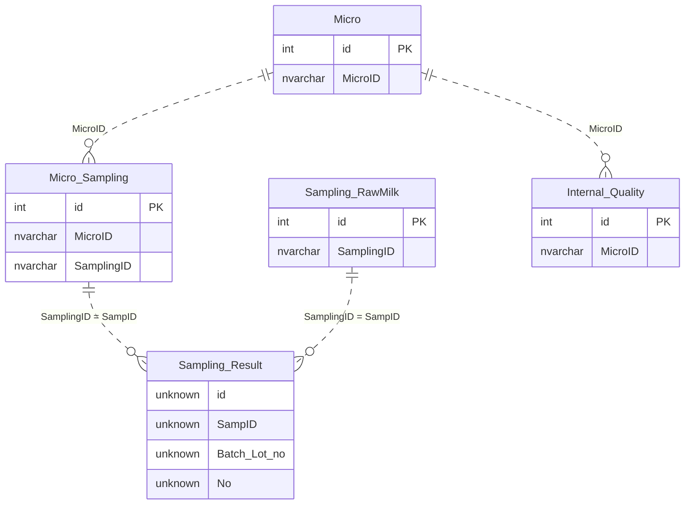

# 🗄️ QSM Microbiological Database Design

[กลับหน้าหลัก](../README.md) · [SQL Query](Query/README.md)

พบ schema ที่นำเข้า Builder **12 ตาราง** และตารางที่ SQL อ้างเพิ่ม **6 ตาราง**. ชนิดข้อมูลมาจาก `externalType` ใน export; ขนาด nvarchar, default, index และ FK constraint ที่ export ไม่ระบุยังไม่ยืนยันจาก SQL Server.

## Table Directory

| Table | หน้าที่ | Schema | เอกสาร |
|---|---|---|---|
| `All_plant_Data` | master โรงงาน แผนก Item Section และ Sample | Builder export | [README](tables/all-plant-data/README.md) |
| `Internal_Quality` | รายการตรวจคุณภาพภายในตาม MicroID: Media/Equipment/Batch และผล pass/positive/negative | Builder export | [README](tables/internal-quality/README.md) |
| `Micro` | หัวงานตรวจ MicroID: ประเภทตัวอย่าง รายการทดสอบ ผู้ส่ง ผู้รับ ผู้ตรวจ ผู้แปลผล ผู้อนุมัติ และสถานะ | Builder export | [README](tables/micro/README.md) |
| `Micro Sampling` | เชื่อม MicroID กับ SamplingID พร้อมวันเวลา Batch/State/DataType ของรายการเก็บตัวอย่าง | Builder export | [README](tables/micro-sampling/README.md) |
| `MPN_INDEX_100ml` | ตาราง lookup ดัชนี MPN สำหรับรูปแบบหลอด/ความเจือจางตามชื่อ | Builder export | [README](tables/mpn-index-100ml/README.md) |
| `MPN_INDEX_100ml_10_0` | ตาราง lookup ดัชนี MPN สำหรับรูปแบบหลอด/ความเจือจางตามชื่อ | Builder export | [README](tables/mpn-index-100ml-10-0/README.md) |
| `MPN_INDEX_100ml_10_1` | ตาราง lookup ดัชนี MPN สำหรับรูปแบบหลอด/ความเจือจางตามชื่อ | Builder export | [README](tables/mpn-index-100ml-10-1/README.md) |
| `MPN_INDEX_100ml_5` | ตาราง lookup ดัชนี MPN สำหรับรูปแบบหลอด/ความเจือจางตามชื่อ | Builder export | [README](tables/mpn-index-100ml-5/README.md) |
| `Price` | ข้อมูลราคา; ไม่พบ SQL query ในชุดนี้อ้างตารางโดยตรง | Builder export | [README](tables/price/README.md) |
| `Sampling RawMilk` | ข้อมูลรับตัวอย่างน้ำนมดิบและผลแยก tank 1–3 | Builder export | [README](tables/sampling-rawmilk/README.md) |
| `Sum_data_type` | master Type และเครื่องจักรสำหรับตัวเลือก | Builder export | [README](tables/sum-data-type/README.md) |
| `tb_app1_login` | ข้อมูลบัญชีที่ Login/ChangePassword ใช้ | Builder export | [README](tables/tb-app1-login/README.md) |
| `Sampling_Result` | ผลตรวจราย sampling/batch/No ทั้ง raw counts และผลคำนวณ | พบ SQL reference เท่านั้น | [README](tables/sampling-result/README.md) |
| `template` | lookup รูปแบบ Check1–Check20 ค่า result และ Power สำหรับสูตรคำนวณ | พบ SQL reference เท่านั้น | [README](tables/template/README.md) |
| `Micro_Queue` | จัดลำดับและสถานะคิวสร้างงาน | พบ SQL reference เท่านั้น | [README](tables/micro-queue/README.md) |
| `Inprocess` | mapping Department/Type/Name/Tank สำหรับตัวอย่างระหว่างกระบวนการ | พบ SQL reference เท่านั้น | [README](tables/inprocess/README.md) |
| `Employee` | ชื่อพนักงานอ้างด้วย code ในรายงาน | พบ SQL reference เท่านั้น | [README](tables/employee/README.md) |
| `MPN_INDEX_100ml_10` | ตาราง lookup ดัชนี MPN สำหรับรูปแบบหลอด/ความเจือจางตามชื่อ | พบ SQL reference เท่านั้น | [README](tables/mpn-index-100ml-10/README.md) |

## ER diagram ของการเชื่อมข้อมูลใน SQL

เส้นสัมพันธ์ด้านล่างอ้างเงื่อนไข JOIN/WHERE ที่พบใน query. Cardinality เป็นแบบจำลองการใช้งาน ไม่ยืนยัน constraint/uniqueness ใน SQL Server. PK `id` แสดงเฉพาะตารางที่ Builder ระบุ. ตาราง Sampling_Result ไม่มี schema ใน export จึงแสดงชนิด `unknown`.

ชื่อใน diagram: Micro_Sampling = `[Micro Sampling]`, Sampling_RawMilk = `[Sampling RawMilk]`. `Caculate 1` ใช้ SampID + Batch_Lot_no + No แต่ `Caculate2` อัปเดตด้วย SampID อย่างเดียว.

## จุดที่มีผลต่อการดูแลระบบ

- `Update_Status` ไม่มี WHERE และคำนวณสถานะทั้ง Micro.
- `Sync_RawMilk_DateTime_To_Micro_Result` เมื่อ Action=load เปลี่ยนวันเวลาทุกแถวที่ JOIN ตรงกัน.
- การตรวจ SQL body พบว่า comment เดิมบางจุดไม่ตรง behavior; เอกสาร Query ยึด statement จริง.
- ตารางที่ไม่มี schema ต้องตรวจใน SQL Server ก่อนทำ DDL/migration.
